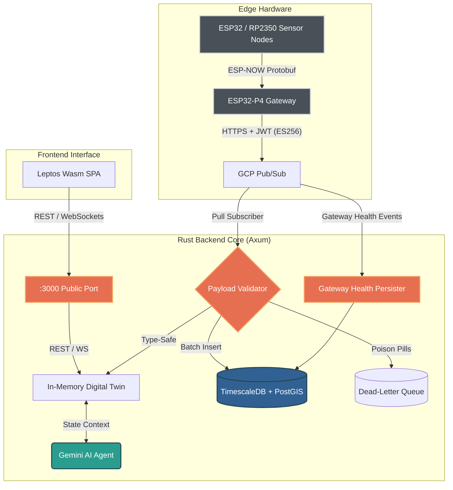

# Oscar Mora | Tecnólogo de Conservación e Ingeniero de Sistemas Embebidos

[](https://oscar-bio.dev/)
[](https://linkedin.com/in/oscar-bio-dev)
[](https://www.rust-lang.org/)
[](https://github.com/tokio-rs/axum)
[](https://www.timescale.com/)
[](https://opensource.org/licenses/MIT)

[English Version](README.md) • [Español](README.es.md)

---

## Sobre Mí

Soy **Tecnólogo de Conservación**, **Biólogo Marino** e **Ingeniero de Sistemas Embebidos** radicado en Pueblo West, Colorado. Uno la investigación ecológica con la instrumentación electrónica de bajo nivel (*bare-metal*), transformando requerimientos ambientales complejos en nodos de monitoreo IoT de ultra bajo consumo, infraestructura de telemetría resistente y plataformas de análisis basadas en datos.

Como fundador de **[EcoWest Instrument](https://oscar-bio.dev/)**, diseño y fabrico sistemas de hardware y software concebidos para operar con alta confiabilidad en entornos remotos y condiciones extremas de campo.

- **Sitio Web y Portafolio:** [https://oscar-bio.dev/](https://oscar-bio.dev/)
- **Especialización:** Monitoreo ambiental in-situ, diseño de sensores de bajo consumo, computación en el borde (*Edge Computing*), arquitecturas distribuidas de series temporales y modelado de biodiversidad edáfica aplicada.
- **Ubicación:** Pueblo West, Colorado, Estados Unidos.

---

## Proyectos Destacados e Iniciativas

- **[EcoWest Instrument](https://oscar-bio.dev/):** Instrumentación científica y comercial para ecosistemas de suelo y acuáticos. Desarrollamos dataloggers autónomos de campo, gateways de telemetría LoRa/ESP-NOW de bajo consumo y arreglos de sensores multiparamétricos.
- **Telemetry Hub (Este Repositorio):** Plataforma asíncrona de ingestión de telemetría edge-to-cloud y gemelo digital (*Digital Twin*) desarrollada con Rust (Axum, Tokio) y Leptos WebAssembly, respaldada por TimescaleDB.
- **Investigación Ecológica y Edáfica:** Estudios aplicados en biodiversidad del suelo y taxonomía de lombrices de tierra, correlacionando métricas continuas de microclima y química edáfica con dinámicas biológicas poblacionales.

---

## Stack Tecnológico

| Dominio | Tecnologías y Herramientas |
|---|---|
| **Lenguajes** | Rust (Backend, WebAssembly), C/C++ Embebido, SQL, Python, Bash |
| **Microcontroladores y Edge** | Espressif (ESP32-P4 Gateway, ESP32-C6, ESP32-WROOM), Raspberry Pi (RP2350, RP2040), STMicroelectronics (STM32) |
| **Firmware y RTOS** | FreeRTOS, ESP-IDF, Pico SDK, Nanopb (Protocol Buffers) |
| **Sensores y Transducción** | Bosch Sensortec BME688 (IAQ, VOC, temp, humedad, presión), Sensirion SCD41 (CO2 NDIR fotoacústico), Bosch BMV080 (Material particulado láser PM1.0/PM2.5/PM10), sondas ópticas de Oxígeno Disuelto y pH |
| **Arquitectura de Backend** | Rust (Axum, Tokio, Tower), Google Cloud Pub/Sub, WebSockets, JWT (ES256), APIs REST |
| **Almacenamiento y Datos Espaciales** | PostgreSQL 16, TimescaleDB (Hypertables, compresión de series temporales), PostGIS (indexación espacial), SQLx |
| **HMI Web y Visualización** | Leptos (WebAssembly / Wasm SPA), estética Gruvbox Hard Dark, sincronización de estado en tiempo real vía WebSockets |
| **Nube e Inteligencia Artificial** | Google Gemini AI (razonamiento contextual sobre el Gemelo Digital), GCP Pub/Sub, Docker Compose |
| **Rigor de Ingeniería** | Cero advertencias con Clippy pedante (`-D warnings`), auditoría automatizada de vulnerabilidades (`cargo audit`), Conventional Commits |

---

## Telemetry Hub: Arquitectura del Proyecto

Este repositorio alberga el código fuente completo del **Ecological Telemetry Hub**, una plataforma edge-to-cloud diseñada para ingerir, validar, persistir y visualizar datos ambientales de alta frecuencia provenientes de sensores en campo.

### Diagrama del Sistema



### Características Técnicas Clave

- **Mega-Schema Unificado (v2.0 - 33 Campos):** Un único contrato Protobuf compartido entre firmware C embebido (Nanopb) y servicios backend en Rust (`prost`), cubriendo métricas físicas (temperatura, humedad, presión), conteo de partículas, resistencia de gas, IAQ, sensores virtuales (eCO2, bVOC) y diagnósticos ópticos.
- **Serialización Sin Pérdida:** Las cargas en tránsito utilizan serialización compacta `f32` para radio y colas en la nube, expandiéndose a `f64` para persistencia analítica de alta precisión en hypertables de TimescaleDB.
- **Ingestión Resiliente en la Nube y DLQ:** El suscriptor Pull asíncrono de GCP Pub/Sub valida la integridad de la carga útil y el formato UUID. Los paquetes malformados ("poison pills") se desvían a una cola de mensajes no procesados (*Dead-Letter Queue*, `telemetry_dlq`) en lugar de generar bucles infinitos de reintento.
- **Gemelo Digital en Memoria:** Representación de estado segura para hilos (`Arc<RwLock<LruCache>>` con tope de 10.000 dispositivos) que ofrece lecturas submilisegundo del estado activo de los nodos para consultas y clientes WebSocket.
- **Integración con IA Cognitiva:** Razonamiento contextual de telemetría impulsado por Google Gemini, consultando el estado del Gemelo Digital bajo un esquema estricto y protección contra inyecciones de prompts.
- **HMI en WebAssembly:** Aplicación de página única (SPA) desarrollada en Rust con Leptos, con reconexión automática vía WebSocket, distintivos de calibración de sensores (`is_calibrating`), alertas de obstrucción láser (`is_laser_obstructed`) y seguimiento de latencia de red sin sobrecarga de JavaScript.

---

## Inicio Rápido (Quick Start)

### Requisitos Previos
- [Rust](https://rustup.rs/) (1.85+ estable)
- [Docker y Docker Compose](https://docs.docker.com/compose/)
- [Trunk](https://trunkrs.dev/) (`cargo install trunk`)

### Instalación y Ejecución

```bash
# 1. Clonar el repositorio
git clone https://github.com/oscar-bio-dev/oscar-bio-dev.git
cd oscar-bio-dev

# 2. Iniciar base de datos y emulador de Pub/Sub
docker compose up -d

# 3. Configurar variables de entorno
cp .env.example .env
# Configura DATABASE_URL y opcionalmente GEMINI_API_KEY en .env

# 4. Compilar el frontend WebAssembly
cd frontend
trunk build
cd ..

# 5. Ejecutar el servidor backend en Rust (ejecuta migraciones automáticamente)
cargo run -p backend
```

Una vez en ejecución, accede localmente a los servicios:
- **Panel Web y API:** `http://localhost:3000/`
- **Documentación Swagger / OpenAPI:** `http://localhost:3000/swagger-ui/`
- **Endpoint de Diagnóstico (Health Check):** `http://localhost:3000/health`

---

## Documentación y Referencias

Los manuales operativos, diseño de arquitectura y guías de desarrollo se encuentran centralizados en `docs/`:

- [Arquitectura del Sistema](docs/ARCHITECTURE.md) - Detalle técnico del Mega-Schema (33 campos), hypertables TimescaleDB, DLQ y modelos de estado.
- [Roadmap de Ingeniería](docs/ROADMAP.md) - Hitos de arquitectura, fases completadas y próximas capacidades.
- [Runbook Operativo](docs/RUNBOOK.md) - Despliegue paso a paso, migraciones de base de datos, validación y recuperación ante desastres.
- [Guía de Contribución](CONTRIBUTING.md) - Estándares de código, compuertas de calidad pedantes con Clippy y flujo de commits.
- [Registro de Cambios](CHANGELOG.md) - Historial cronológico de versiones y migraciones.

---

## Contacto y Redes

- **Sitio Web Personal:** [https://oscar-bio.dev/](https://oscar-bio.dev/)
- **Empresa:** [EcoWest Instrument](https://oscar-bio.dev/)
- **LinkedIn:** [oscar-bio-dev](https://linkedin.com/in/oscar-bio-dev)
- **Correo Electrónico:** [oscar_bio_dev@outlook.com](mailto:oscar_bio_dev@outlook.com)
