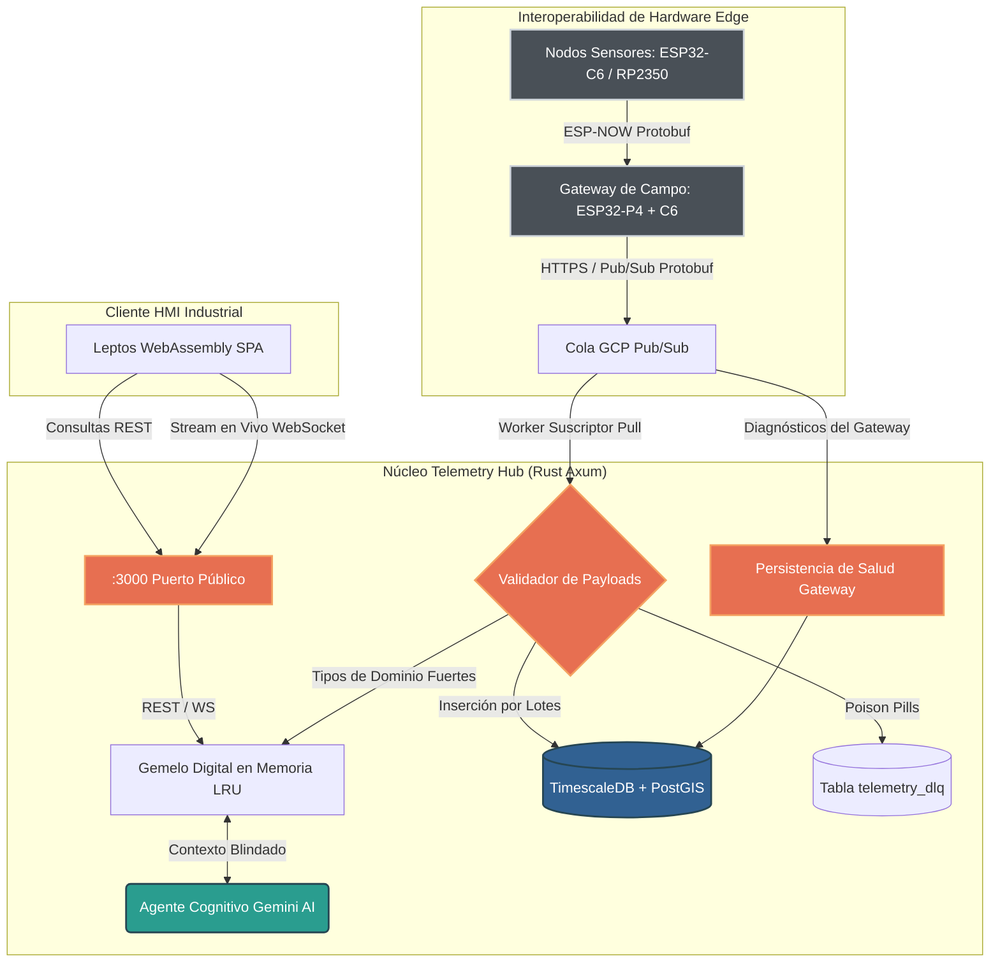

# Ecological Telemetry Hub (Hub de Telemetría Ecológica)

[](https://github.com/oscar-bio-dev/telemetry-hub)
[](https://www.rust-lang.org/)
[](https://github.com/tokio-rs/axum)
[](https://leptos.dev/)
[](https://www.timescale.com/)
[](LICENSE)

[English Version](README.md) • [Español](README.es.md)

---

## Descripción General

El **Ecological Telemetry Hub** (`telemetry-hub`) es un motor de ingesta de telemetría edge-to-cloud, caché de estado de gemelo digital y plataforma de supervisión SCADA en tiempo real diseñada para instrumentación ambiental de alta frecuencia. Desarrollada por **EcoWest Instrument**, la plataforma recibe datos de sensores físicos y virtuales desplegados en campo, valida los contratos de datos mediante un mega-esquema canónico en Protocol Buffers de 33 campos, persiste las series temporales en hypertables de TimescaleDB y visualiza las métricas en vivo mediante una HMI reactiva compilada en WebAssembly sin sobrecarga de JavaScript.

La plataforma implementa estándares de ingeniería de grado espacial: confiabilidad garantizada sin pánicos en producción (*zero-panic*), aislamiento resiliente de paquetes corruptos mediante una cola de mensajes no procesados (*Dead-Letter Queue* - DLQ), recuperación de estado en memoria submilisegunda y razonamiento generativo contextual mediante Google Gemini AI blindado contra ataques de inyección de prompts.

---

## Arquitectura del Sistema



---

## Estructura del Workspace

El repositorio está organizado como un workspace de Cargo unificado que garantiza la separación de responsabilidades:

```
telemetry-hub/
├── backend/                  # Servidor backend asíncrono en Rust Axum
│   ├── src/api/              # Handlers REST, WebSockets, Autenticación, consola DLQ y Chat IA
│   ├── src/domain/           # Gemelo digital en memoria (LRU), estado concurrente y modelos de dominio
│   ├── src/infrastructure/   # Conexión a TimescaleDB, migraciones SQLx y suscriptor GCP Pub/Sub
│   ├── src/bin/              # Emulador sintético de hardware para pruebas (dummy_publisher)
│   └── migrations/           # Migraciones SQL versionadas (hypertables, índices espaciales, DLQ)
├── frontend/                 # Aplicación SPA cliente en WebAssembly (Leptos 0.6)
│   ├── src/pages/            # Vistas de dominio (Monitoreo de Sala, Consola DLQ, Terminal IA, Analítica)
│   ├── src/components/       # Widgets de interfaz reutilizables (NodeCard, LEDs de estado, Sparklines)
│   └── style.css             # Sistema de diseño industrial en paleta Gruvbox Hard Dark
├── shared/                   # Tipos compartidos, reglas de validación y DTOs de Protocol Buffers
│   ├── src/lib.rs            # Tipos envoltorio con rango físico (Ph, Temperature, Iaq), TryFrom de cable
│   └── Cargo.toml            # Dependencias compartidas entre backend y frontend Wasm
├── proto/                    # Esquemas canónicos de Protocol Buffers (Fuente única de verdad)
│   ├── telemetry.proto       # Mega-Esquema v2.0 (33 campos: ambientales, virtuales, partículas, diagnósticos)
│   └── gateway_health.proto  # Eventos de salud del Gateway (estado MicroSD, memoria heap, uptime, alertas)
├── docs/                     # Documentación técnica, manuales de arquitectura y runbooks
│   ├── ARCHITECTURE.md       # Especificaciones de arquitectura, modelos de base de datos y estado
│   ├── API.md                # Manual exhaustivo de Protocol Buffers, Pub/Sub, REST y WebSockets
│   ├── ROADMAP.md            # Hitos de arquitectura, fases completadas y próximas capacidades
│   └── RUNBOOK.md            # Guía operativa paso a paso, migraciones y recuperación ante desastres
├── .github/                  # Flujos de CI/CD, configuración de Dependabot y plantillas de issues/PRs
└── docker-compose.yml        # Entorno local de TimescaleDB (PostgreSQL 15) y emulador de GCP Pub/Sub
```

---

## Stack Tecnológico

La plataforma está construida con tecnologías seguras en memoria, concurrentes y de nivel industrial:

| Componente | Tecnología | Descripción |
|---|---|---|
| **Lenguaje Core** | [Rust](https://www.rust-lang.org/) (1.85+ estable) | Lenguaje de sistemas con garantías de memoria que impulsa el backend, contratos y WebAssembly |
| **Framework Backend** | [Axum 0.7](https://github.com/tokio-rs/axum) y [Tokio](https://tokio.rs/) | Motor asíncrono de alto rendimiento para APIs REST y WebSockets con middlewares de Tower |
| **HMI y Frontend** | [Leptos 0.6](https://leptos.dev/) y [Trunk](https://trunkrs.dev/) | Interfaz SPA en WebAssembly (Wasm) reactiva con refresco de staleness a 1Hz y sparklines SVG |
| **Contratos de Serialización** | [Protocol Buffers (proto3)](https://protobuf.dev/) y [prost](https://github.com/tokio-rs/prost) | Serialización binaria compacta con ensanchamiento sin pérdida (`f32` en cable -> `f64` en almacenamiento) |
| **Persistencia y Series Temporales** | [TimescaleDB](https://www.timescale.com/) y [PostgreSQL 15](https://www.postgresql.org/) | Hypertables con particionamiento cada 7 días y políticas automáticas de compresión (>85% de ahorro en disco) |
| **Datos Espaciales** | [PostGIS](https://postgis.net/) | Indexación espacial y modelado geográfico para flotas de nodos de monitoreo ambiental |
| **Cola de Ingesta en la Nube** | [Google Cloud Pub/Sub](https://cloud.google.com/pubsub) | Intermediario de mensajería desacoplado con suscriptor asíncrono Pull de alta resiliencia |
| **Inteligencia Cognitiva** | [Google Gemini AI](https://deepmind.google/technologies/gemini/) | Razonamiento contextual sobre el Gemelo Digital con aislamiento defensivo contra prompt injection (XPIA) |
| **Seguridad y Compuertas de Calidad** | [Clippy Pedantic](https://rust-lang.github.io/rust-clippy/) y [cargo-audit](https://crates.io/crates/cargo-audit) | Linter estricto sin advertencias (`-D warnings`), verificación en tiempo constante, CORS fail-closed |
| **Infraestructura y CI** | [Docker Compose](https://docs.docker.com/compose/) y GitHub Actions | Contenedores deterministas para desarrollo local y pipelines automatizados de calidad |

---

## Ingestión Edge e Interoperabilidad de Hardware

Aunque `telemetry-hub` es una plataforma de servidor y HMI, está diseñada para procesar telemetría originada en nodos físicos de campo:

- **Mega-Esquema Canónico Unificado (v2.0 - 33 Campos):** Esquema binario único (`proto/telemetry.proto`) que cubre variables físicas (temperatura, humedad, presión), conteo y masa de partículas láser (BMV080), resistencia de gas MOX e IAQ calculado (BME688), sensores virtuales (eCO2, bVOC, tvoc) y alertas ópticas de obstrucción.
- **Optimización en el Cable:** Los microcontroladores de campo (ESP32-P4, ESP32-C6, RP2350) transmiten datos en formato binario compacto `f32` mediante Nanopb o `prost`, minimizando el tiempo de transmisión por radiofrecuencia y el consumo de ancho de banda.
- **Cola de Mensajes No Procesados (DLQ):** Toda carga útil que no cumpla la decodificación Protobuf, contenga un UUID corrupto o viole los rangos de validación del dominio se trunca a 4 KB y se guarda en la tabla `telemetry_dlq` sin interrumpir el flujo continuo de ingesta.

---

## Inicio Rápido (Quick Start)

### Requisitos Previos
- [Rust](https://rustup.rs/) (herramientas 1.85+ estables)
- [Docker y Docker Compose](https://docs.docker.com/compose/)
- [Trunk](https://trunkrs.dev/) (`cargo install trunk`)
- Target `wasm32-unknown-unknown` (`rustup target add wasm32-unknown-unknown`)

### Instalación y Ejecución

```bash
# 1. Clonar el repositorio
git clone https://github.com/oscar-bio-dev/telemetry-hub.git
cd telemetry-hub

# 2. Iniciar base de datos y emulador de Pub/Sub
docker compose up -d

# 3. Configurar variables de entorno
cp .env.example .env
# Configura DATABASE_URL, JWT_SECRET y opcionalmente GEMINI_API_KEY en .env

# 4. Compilar el frontend WebAssembly
cd frontend
trunk build
cd ..

# 5. Ejecutar el servidor backend en Rust (aplica migraciones automáticamente)
cargo run -p backend
```

### Simulación de Telemetría

Para inyectar datos sintéticos de múltiples sensores en el entorno local sin requerir hardware físico:

```bash
# En una terminal independiente, inicia el publicador sintético:
cargo run -p backend --bin dummy_publisher
```

Una vez en ejecución, los servicios estarán disponibles en:
- **Panel Web y HMI:** `http://localhost:3000/` (o `http://localhost:8080/` durante desarrollo con Trunk)
- **Documentación Swagger / OpenAPI:** `http://localhost:3000/swagger-ui/` (habilitada en modo debug o con `ENABLE_SWAGGER=true`)
- **Probes de Salud y Disponibilidad:** `http://localhost:3000/health` y `http://localhost:3000/ready`
- **Stream en Tiempo Real WebSocket:** `ws://localhost:3000/api/ws`

---

## Documentación y Referencias de Ingeniería

Los manuales de arquitectura, referencias de protocolos y procedimientos operativos se ubican en `docs/`:

- [Arquitectura del Sistema](docs/ARCHITECTURE.md) - Diseño de hypertables, políticas de retención y estado del gemelo digital.
- [Manual de API y Protocolos](docs/API.md) - Especificación completa de Protocol Buffers, contratos Pub/Sub, endpoints REST y WebSockets.
- [Roadmap de Ingeniería](docs/ROADMAP.md) - Hitos del proyecto, fases completadas y próximas capacidades.
- [Runbook Operativo](docs/RUNBOOK.md) - Procedimientos de despliegue, ejecución de migraciones y recuperación ante desastres.
- [Guía de Contribución](CONTRIBUTING.md) - Estándares de desarrollo, compuertas de calidad pedantes con Clippy y flujo de trabajo con commits.
- [Política de Seguridad](SECURITY.md) - Modelo de amenazas Zero-Trust, divulgación coordinada y hardening del perímetro.
- [Código de Conducta](CODE_OF_CONDUCT.md) - Compromiso Contributor Covenant y normas de la comunidad.
- [Registro de Cambios](CHANGELOG.md) - Historial de versiones generado de forma automatizada con `git-cliff`.

---

## Organización y Mantenedores

El **Ecological Telemetry Hub** es desarrollado y mantenido por **EcoWest Instrument**.

- **Arquitecto Principal:** Oscar Mora
- **Organización:** EcoWest Instrument (Pueblo West, Colorado)
- **Repositorio:** [https://github.com/oscar-bio-dev/telemetry-hub](https://github.com/oscar-bio-dev/telemetry-hub)
- **Sitio Web:** [https://oscar-bio.dev/](https://oscar-bio.dev/)
- **Contacto:** [oscar_bio_dev@outlook.com](mailto:oscar_bio_dev@outlook.com)
