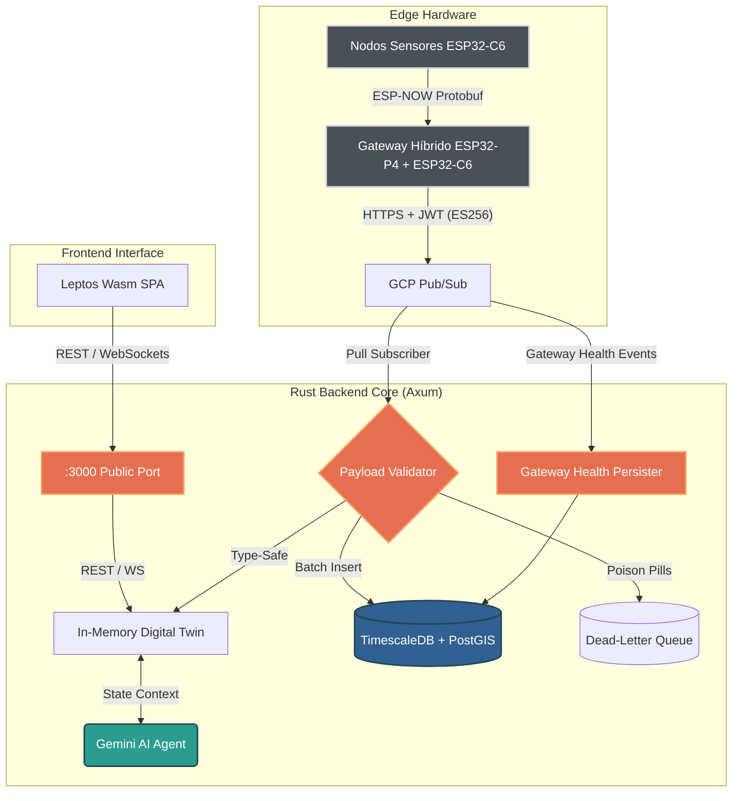

# Ecological Telemetry Hub (Hub de Telemetría Ecológica)

[](https://github.com/oscar-bio-dev/telemetry-hub)
[](https://www.rust-lang.org/)
[](https://github.com/tokio-rs/axum)
[](https://www.timescale.com/)
[](LICENSE)

[English Version](README.md) • [Español](README.es.md)

---

## Descripción General

El **Ecological Telemetry Hub** es una plataforma distribuida edge-to-cloud diseñada para la ingesta de datos ambientales de alta frecuencia, validación estricta de contratos, persistencia espacio-temporal y visualización en tiempo real. Desarrollada por **EcoWest Instrument**, la plataforma conecta nodos de sensores desplegados en campo (suelo, agua, atmósfera) con un backend asíncrono en Rust (Axum, Tokio) y una interfaz HMI reactiva compilada en WebAssembly (Leptos).

La plataforma garantiza confiabilidad sin pánicos en producción, aislamiento de cargas corruptas mediante colas de mensajes no procesados (*Dead-Letter Queue* - DLQ) con verificación Zero-Trust de operador, almacenamiento en memoria submilisegundo del Gemelo Digital y razonamiento contextual mediante Google Gemini AI blindado contra ataques de inyección de prompts.

---

## Arquitectura del Sistema



---

## Características Técnicas Clave

- **Mega-Schema Unificado (v2.0 - 33 Campos):** Un único contrato Protobuf canónico compartido entre firmware C embebido (Nanopb) y servicios backend en Rust (`prost`), cubriendo métricas físicas (temperatura, humedad, presión), conteo de partículas (BMV080), resistencia de gas (BME688), IAQ, sensores virtuales (eCO2, bVOC) y diagnósticos ópticos.
- **Serialización Sin Pérdida:** Las cargas en tránsito utilizan serialización compacta `f32` para radio y colas en la nube, expandiéndose a `f64` para persistencia analítica de alta precisión en hypertables de TimescaleDB.
- **Ingestión Resiliente en la Nube y DLQ:** El suscriptor Pull asíncrono de GCP Pub/Sub valida la integridad de la carga útil y el formato UUIDv4 canónico. Los paquetes malformados ("poison pills") se truncan defensivamente a 4KB y se desvían a una cola de mensajes no procesados (*Dead-Letter Queue*, `telemetry_dlq`) inspeccionable desde una consola autenticada Zero-Trust.
- **Gemelo Digital en Memoria:** Representación de estado segura para hilos (`Arc<RwLock<LruCache>>` con tope de 10.000 dispositivos) que ofrece lecturas submilisegundo del estado activo de los nodos para consultas y clientes WebSocket.
- **Integración con IA Cognitiva:** Razonamiento contextual de telemetría impulsado por Google Gemini, consultando el estado del Gemelo Digital bajo un esquema estricto y protección contra ataques Cross-Prompt Injection (XPIA).
- **HMI Granular en WebAssembly (Leptos):** Interfaz industrial de alta densidad con reactividad de staleness aislada a 1Hz (cero recreación del DOM en gráficas o tarjetas), líneas de tendencia SVG en vivo, LEDs indicadores de estado (`NodeStatus`) y 5 vistas técnicas de dominio sin sobrecarga de JavaScript.

---

## Stack Tecnológico

| Dominio | Tecnologías y Herramientas |
|---|---|
| **Lenguajes** | Rust (Backend, WebAssembly), C/C++ Embebido, SQL, Python, Bash |
| **Microcontroladores y Edge** | Espressif (ESP32-P4 Gateway, ESP32-C6, ESP32-WROOM), Raspberry Pi (RP2350, RP2040), STMicroelectronics (STM32) |
| **Firmware y RTOS** | FreeRTOS, ESP-IDF, Pico SDK, Nanopb (Protocol Buffers) |
| **Sensores y Transducción** | Bosch Sensortec BME688 (IAQ, VOC, temp, humedad, presión), Sensirion SCD41 (CO2 NDIR fotoacústico), Bosch BMV080 (Material particulado láser PM1.0/PM2.5/PM10), sondas ópticas de Oxígeno Disuelto y pH |
| **Arquitectura de Backend** | Rust (Axum 0.7, Tokio, Tower), Google Cloud Pub/Sub, WebSockets, JWT (HS256), APIs REST |
| **Almacenamiento y Datos Espaciales** | PostgreSQL 15, TimescaleDB (Hypertables, compresión de series temporales), PostGIS (indexación espacial), SQLx |
| **HMI Web y Visualización** | Leptos 0.6 (WebAssembly / Wasm SPA), estética Gruvbox Hard Dark, sincronización WebSocket en tiempo real, 5 vistas de navegación de dominio |
| **Nube e Inteligencia Artificial** | Google Gemini AI (razonamiento contextual sobre el Gemelo Digital), GCP Pub/Sub, Docker Compose |
| **Rigor de Ingeniería** | Cero advertencias con Clippy pedante (`-D warnings`), auditoría automatizada de vulnerabilidades (`cargo audit`), Conventional Commits |

---

## Inicio Rápido (Quick Start)

### Requisitos Previos
- [Rust](https://rustup.rs/) (1.85+ estable)
- [Docker y Docker Compose](https://docs.docker.com/compose/)
- [Trunk](https://trunkrs.dev/) (`cargo install trunk`)

### Instalación y Ejecución

```bash
# 1. Clonar el repositorio
git clone https://github.com/oscar-bio-dev/telemetry-hub.git
cd telemetry-hub

# 2. Iniciar base de datos y emulador de Pub/Sub
docker compose up -d

# 3. Configurar variables de entorno
cp .env.example .env
# Configura DATABASE_URL, JWT_SECRET y opcionalmente GEMINI_API_KEY en .env

# 4. Compilar el frontend WebAssembly
cd frontend
trunk build
cd ..

# 5. Ejecutar el servidor backend en Rust (ejecuta migraciones automáticamente)
cargo run -p backend
```

Una vez en ejecución, accede localmente a los servicios:
- **Panel Web y HMI:** `http://localhost:3000/` (o `http://localhost:8080/` durante desarrollo activo con Trunk)
- **Documentación Swagger / OpenAPI:** `http://localhost:3000/swagger-ui/` (habilitada en modo debug o con `ENABLE_SWAGGER=true`)
- **Endpoints de Diagnóstico y Disponibilidad:** `http://localhost:3000/health` y `http://localhost:3000/ready`

---

## Documentación y Referencias

Los manuales operativos, diseño de arquitectura y guías de desarrollo se encuentran centralizados en `docs/`:

- [Arquitectura del Sistema](docs/ARCHITECTURE.md) - Detalle técnico del Mega-Schema (33 campos), hypertables TimescaleDB, DLQ y modelos de estado.
- [Roadmap de Ingeniería](docs/ROADMAP.md) - Hitos de arquitectura, fases completadas y próximas capacidades.
- [Runbook Operativo](docs/RUNBOOK.md) - Despliegue paso a paso, migraciones de base de datos, validación y recuperación ante desastres.
- [Guía de Contribución](CONTRIBUTING.md) - Estándares de código, compuertas de calidad pedantes con Clippy y flujo de commits.
- [Política de Seguridad](SECURITY.md) - Proceso de divulgación coordinada de vulnerabilidades y modelo de amenazas.
- [Código de Conducta](CODE_OF_CONDUCT.md) - Estándares de la comunidad y compromiso Contributor Covenant.
- [Registro de Cambios](CHANGELOG.md) - Historial cronológico de versiones y migraciones.

---

## Autor y Mantenedor

Desarrollado y mantenido por **Oscar Mora** ([EcoWest Instrument](https://oscar-bio.dev/)).

- **Sitio Web Personal:** [https://oscar-bio.dev/](https://oscar-bio.dev/)
- **LinkedIn:** [oscar-bio-dev](https://linkedin.com/in/oscar-bio-dev)
- **Correo Electrónico:** [oscar_bio_dev@outlook.com](mailto:oscar_bio_dev@outlook.com)
