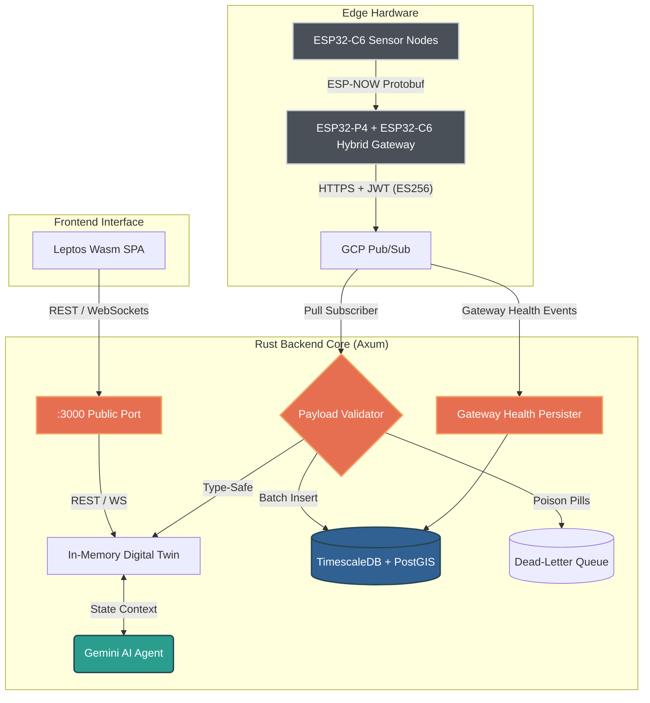

# Ecological Telemetry Hub

[](https://github.com/oscar-bio-dev/telemetry-hub)
[](https://www.rust-lang.org/)
[](https://github.com/tokio-rs/axum)
[](https://www.timescale.com/)
[](LICENSE)

[English](README.md) • [Versión en Español](README.es.md)

---

## Overview

The **Ecological Telemetry Hub** is an edge-to-cloud distributed platform engineered for high-frequency environmental data ingestion, strict contract validation, spatial-temporal persistence, and real-time visualization. Developed by **EcoWest Instrument**, the platform connects field-deployed sensors (soil, aquatic, atmospheric) to an asynchronous Rust backend (Axum, Tokio) and a reactive WebAssembly HMI (Leptos).

The platform enforces zero-panic reliability, poison-pill dead-letter queueing (DLQ) with zero-trust operator verification, sub-millisecond in-memory digital twin caching, and contextual reasoning with Google Gemini AI shielded against prompt injection.

---

## System Architecture



---

## Key Technical Characteristics

- **Unified Mega-Schema (v2.0 - 33 Fields):** A single canonical Protobuf contract shared between embedded C firmware (Nanopb) and backend Rust services (`prost`), spanning physical metrics (temperature, humidity, pressure), particulate counts (BMV080), gas resistance (BME688), IAQ, virtual sensors (eCO2, bVOC), and optical diagnostics.
- **Lossless Serialization:** Wire payloads use compact `f32` serialization over radio and cloud queues, safely widening into `f64` for high-precision analytical persistence in TimescaleDB hypertables.
- **Resilient Cloud Ingestion & DLQ:** Asynchronous GCP Pub/Sub Pull Subscriber verifies payload integrity and validates canonical UUIDv4 format. Malformed packets ("poison pills") are defensively truncated to 4KB and diverted to a dedicated Dead-Letter Queue (`telemetry_dlq`) with an authenticated Zero-Trust operator console.
- **In-Memory Digital Twin:** Thread-safe state representation (`Arc<RwLock<LruCache>>` capped at 10,000 devices) delivering sub-millisecond retrieval of active sensor node states for queries and WebSocket clients.
- **Cognitive AI Integration:** Context-aware telemetry reasoning powered by Google Gemini, querying real-time Digital Twin state under strict schema and Cross-Prompt Injection Attack (XPIA) defenses.
- **Granular WebAssembly HMI (Leptos):** High-density industrial SCADA interface featuring isolated 1Hz staleness reactivity (zero DOM recreation of sparklines or metric cards), live SVG trend sparklines, hardware LED status indicators (`NodeStatus`), and 5 dedicated domain views without JavaScript overhead.

---

## Tech Stack

| Domain | Technologies & Tools |
|---|---|
| **Languages** | Rust (Backend, WebAssembly), Embedded C/C++, SQL, Python, Bash |
| **Microcontrollers & Edge** | Espressif (ESP32-P4 Gateway, ESP32-C6, ESP32-WROOM), Raspberry Pi (RP2350, RP2040), STMicroelectronics (STM32) |
| **Firmware & RTOS** | FreeRTOS, ESP-IDF, Pico SDK, Nanopb (Protocol Buffers) |
| **Sensors & Transduction** | Bosch Sensortec BME688 (IAQ, VOC, temp, humidity, pressure), Sensirion SCD41 (Photoacoustic NDIR CO2), Bosch BMV080 (Laser Particulate PM1.0/PM2.5/PM10), Optical Dissolved Oxygen & pH probes |
| **Backend Architecture** | Rust (Axum 0.7, Tokio, Tower), Google Cloud Pub/Sub, WebSockets, JWT (HS256), REST APIs |
| **Storage & Spatial Data** | PostgreSQL 15, TimescaleDB (Hypertables, compression policies), PostGIS (spatial indexing), SQLx |
| **Web HMI & Dashboard** | Leptos 0.6 (WebAssembly / Wasm SPA), Gruvbox Hard Dark theme, real-time WebSocket sync, 5 technical domain views |
| **Cloud & Intelligence** | Google Gemini AI (Cognitive Digital Twin contextual telemetry reasoning), GCP Pub/Sub, Docker Compose |
| **Engineering Rigor** | Zero-warning pedantic Clippy (`-D warnings`), automated vulnerability auditing (`cargo audit`), Conventional Commits |

---

## Quick Start

### Prerequisites
- [Rust](https://rustup.rs/) (1.85+ stable)
- [Docker & Docker Compose](https://docs.docker.com/compose/)
- [Trunk](https://trunkrs.dev/) (`cargo install trunk`)

### Setup & Run

```bash
# 1. Clone the repository
git clone https://github.com/oscar-bio-dev/telemetry-hub.git
cd telemetry-hub

# 2. Launch database and Pub/Sub emulator
docker compose up -d

# 3. Configure environment variables
cp .env.example .env
# Edit .env to set your DATABASE_URL, JWT_SECRET, and optional GEMINI_API_KEY

# 4. Build the WebAssembly frontend
cd frontend
trunk build
cd ..

# 5. Run the Axum backend server (runs migrations automatically)
cargo run -p backend
```

Once running, access the services locally:
- **Web Dashboard & HMI:** `http://localhost:3000/` (or `http://localhost:8080/` during active Trunk development)
- **Swagger / OpenAPI Documentation:** `http://localhost:3000/swagger-ui/` (enabled in debug mode or via `ENABLE_SWAGGER=true`)
- **Health Check & Readiness Endpoints:** `http://localhost:3000/health` & `http://localhost:3000/ready`

---

## Documentation & References

Technical deep dives, operation guides, and project management artifacts are located in `docs/`:

- [System Architecture](docs/ARCHITECTURE.md) - Deep dive into Mega-Schema (33 fields), TimescaleDB hypertables, DLQ, and state models.
- [Engineering Roadmap](docs/ROADMAP.md) - Architectural milestones, completed phases, and upcoming features.
- [Operational Runbook](docs/RUNBOOK.md) - Deployment, database migrations, service validation, and disaster recovery procedures.
- [Contributing Guidelines](CONTRIBUTING.md) - Code standards, pedantic clippy quality gates, and commit workflow.
- [Security Policy](SECURITY.md) - Vulnerability disclosure process, threat model, and defense-in-depth architecture.
- [Code of Conduct](CODE_OF_CONDUCT.md) - Community standards and Contributor Covenant pledge.
- [Changelog](CHANGELOG.md) - Chronological release notes and migration history.

---

## Author & Maintainer

Developed and maintained by **Oscar Mora** ([EcoWest Instrument](https://oscar-bio.dev/)).

- **Portfolio & Website:** [https://oscar-bio.dev/](https://oscar-bio.dev/)
- **LinkedIn:** [oscar-bio-dev](https://linkedin.com/in/oscar-bio-dev)
- **Email:** [oscar_bio_dev@outlook.com](mailto:oscar_bio_dev@outlook.com)
