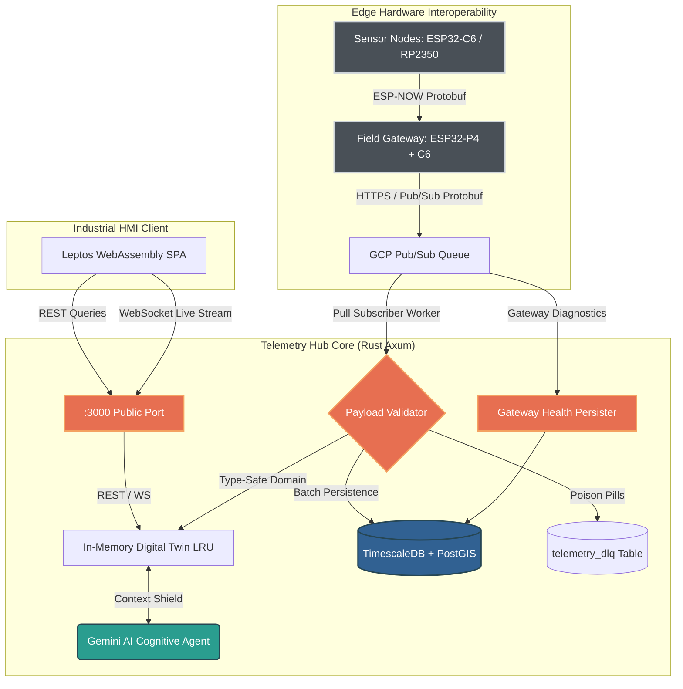

# Ecological Telemetry Hub

[](https://github.com/oscar-bio-dev/telemetry-hub)
[](https://www.rust-lang.org/)
[](https://github.com/tokio-rs/axum)
[](https://leptos.dev/)
[](https://www.timescale.com/)
[](LICENSE)

[English](README.md) • [Versión en Español](README.es.md)

---

## Overview

The **Ecological Telemetry Hub** (`telemetry-hub`) is an edge-to-cloud telemetry ingestion engine, digital twin state cache, and real-time SCADA monitoring platform engineered for high-frequency environmental instrumentation. Developed by **EcoWest Instrument**, the platform receives physical and virtual sensor data from field-deployed hardware nodes, validates data contracts using a canonical 33-field Protocol Buffers mega-schema, persists time-series observations in TimescaleDB hypertables, and visualizes live fleet metrics through a zero-JS WebAssembly HMI.

The platform enforces space-grade reliability standards: zero-panic runtime guarantees, resilient poison-pill isolation via a Dead-Letter Queue (DLQ), sub-millisecond in-memory state retrieval, and generative telemetry reasoning powered by Google Gemini AI shielded against prompt injection attacks.

---

## System Architecture



---

## Workspace Structure

The repository is structured as a unified Cargo workspace enforcing clean separation of concerns:

```
telemetry-hub/
├── backend/                  # Asynchronous Rust Axum backend server
│   ├── src/api/              # REST handlers, WebSockets, Auth, DLQ console, and AI Chat
│   ├── src/domain/           # In-memory Digital Twin (LRU), shared state, and business models
│   ├── src/infrastructure/   # TimescaleDB pool, SQLx migrations, and GCP Pub/Sub subscriber
│   ├── src/bin/              # Synthetic hardware telemetry generator (dummy_publisher)
│   └── migrations/           # Versioned SQL migrations (hypertables, spatial indexes, DLQ)
├── frontend/                 # Client-side WebAssembly Single Page Application (Leptos 0.6)
│   ├── src/pages/            # Domain views (Room Monitoring, DLQ Console, AI Terminal, Analytics)
│   ├── src/components/       # Reusable UI widgets (NodeCard, Status LEDs, Live Sparklines)
│   └── style.css             # Industrial Gruvbox Hard Dark CSS design system
├── shared/                   # Shared types, validation rules, and Protobuf DTOs
│   ├── src/lib.rs            # Physical range newtypes (Ph, Temperature, Iaq), TryFrom wire conversions
│   └── Cargo.toml            # Dependencies shared across backend and frontend targets
├── proto/                    # Canonical Protocol Buffers schemas (Single Source of Truth)
│   ├── telemetry.proto       # Mega-Schema v2.0 (33 fields: physical, virtual, particulate, diagnostics)
│   └── gateway_health.proto  # Edge Gateway health events (MicroSD status, heap, uptime, alerts)
├── docs/                     # Engineering documentation, architecture manuals, and runbooks
│   ├── ARCHITECTURE.md       # Technical architecture, database schemas, and state specifications
│   ├── API.md                # Comprehensive Protocol Buffers, Pub/Sub, REST, and WebSocket manual
│   ├── ROADMAP.md            # Architectural milestones, completed phases, and future capabilities
│   └── RUNBOOK.md            # Step-by-step operations, migrations, and disaster recovery guide
├── .github/                  # CI/CD pipelines, Dependabot, issue and PR templates
└── docker-compose.yml        # Local TimescaleDB (PostgreSQL 15) and GCP Pub/Sub emulator
```

---

## Technology Stack

The platform is built exclusively on high-performance, memory-safe, and industrial-grade technologies:

| Platform Component | Technology & Tooling | Description |
|---|---|---|
| **Core Language** | [Rust](https://www.rust-lang.org/) (1.85+ stable) | Memory-safe systems language powering backend services, shared schemas, and WebAssembly |
| **Backend Framework** | [Axum 0.7](https://github.com/tokio-rs/axum) & [Tokio](https://tokio.rs/) | Asynchronous, concurrent HTTP and WebSocket engine with Tower middlewares |
| **HMI & Frontend** | [Leptos 0.6](https://leptos.dev/) & [Trunk](https://trunkrs.dev/) | Reactive WebAssembly (Wasm) SPA featuring isolated 1Hz staleness updates and live SVG sparklines |
| **Serialization Contracts** | [Protocol Buffers (proto3)](https://protobuf.dev/) & [prost](https://github.com/tokio-rs/prost) | Compact binary serialization with lossless widening (`f32` wire -> `f64` storage) |
| **Persistence & Time-Series** | [TimescaleDB](https://www.timescale.com/) & [PostgreSQL 15](https://www.postgresql.org/) | Hypertables with 7-day chunk partitioning, automatic compression policies (>85% disk savings) |
| **Geospatial Processing** | [PostGIS](https://postgis.net/) | Spatial indexing and geographical coordinates modeling for mobile sensor fleets |
| **Cloud Ingestion Queue** | [Google Cloud Pub/Sub](https://cloud.google.com/pubsub) | Scalable, asynchronous message broker with resilient pull subscriber worker |
| **Cognitive Intelligence** | [Google Gemini AI](https://deepmind.google/technologies/gemini/) | Context-aware Digital Twin telemetry reasoning with Cross-Prompt Injection Attack (XPIA) isolation |
| **Security & Quality Gates** | [Clippy Pedantic](https://rust-lang.github.io/rust-clippy/) & [cargo-audit](https://crates.io/crates/cargo-audit) | Zero-warning strict linting (`-D warnings`), constant-time auth verification, fail-closed CORS |
| **Infrastructure & CI** | [Docker Compose](https://docs.docker.com/compose/) & GitHub Actions | Deterministic local multi-container environments and automated quality pipelines |

---

## Edge Ingestion & Hardware Interoperability

While `telemetry-hub` is a server-side and HMI platform, it is engineered to ingest telemetry from field-deployed hardware nodes:

- **Unified Mega-Schema (v2.0 - 33 Fields):** Canonical contract (`proto/telemetry.proto`) spanning physical variables (temperature, humidity, pressure), laser particulate mass and count (BMV080), MOX gas resistance and calculated IAQ (BME688), virtual sensors (eCO2, bVOC, tvoc), and optical obstruction diagnostics.
- **Wire Optimization:** Edge microcontrollers (e.g. ESP32-P4, ESP32-C6, RP2350) serialize compact `f32` values via Nanopb or `prost`, minimizing RF transmission time and cloud bandwidth.
- **Poison-Pill Dead-Letter Queue (DLQ):** Payloads failing Protobuf decoding, canonical UUIDv4 verification, or domain range validations are truncated defensively to 4 KB and routed to the `telemetry_dlq` table, ensuring non-blocking pipeline execution.

---

## Quick Start

### Prerequisites
- [Rust](https://rustup.rs/) (1.85+ stable toolchain)
- [Docker & Docker Compose](https://docs.docker.com/compose/)
- [Trunk](https://trunkrs.dev/) (`cargo install trunk`)
- `wasm32-unknown-unknown` target (`rustup target add wasm32-unknown-unknown`)

### Setup & Execution

```bash
# 1. Clone the repository
git clone https://github.com/oscar-bio-dev/telemetry-hub.git
cd telemetry-hub

# 2. Start TimescaleDB and the GCP Pub/Sub emulator
docker compose up -d

# 3. Configure environment variables
cp .env.example .env
# Edit .env to set your DATABASE_URL, JWT_SECRET, and optional GEMINI_API_KEY

# 4. Build the WebAssembly frontend
cd frontend
trunk build
cd ..

# 5. Start the Axum backend server (automatically executes database migrations)
cargo run -p backend
```

### Simulating Telemetry Ingestion

To feed synthetic multi-sensor data into the local pipeline without physical edge hardware:

```bash
# In a separate terminal, launch the synthetic data publisher:
cargo run -p backend --bin dummy_publisher
```

Once running, access the local services:
- **Web HMI Dashboard:** `http://localhost:3000/` (or `http://localhost:8080/` during active Trunk development)
- **Interactive Swagger UI:** `http://localhost:3000/swagger-ui/` (enabled in debug mode or via `ENABLE_SWAGGER=true`)
- **Health & Readiness Probes:** `http://localhost:3000/health` & `http://localhost:3000/ready`
- **Real-Time WebSocket Stream:** `ws://localhost:3000/api/ws`

---

## Documentation & Engineering References

Detailed specifications, runbooks, and engineering guidelines are available in the `docs/` directory:

- [System Architecture](docs/ARCHITECTURE.md) - Deep dive into database hypertables, compression policies, and state representation.
- [API & Protocol Manual](docs/API.md) - Complete documentation for Protocol Buffers schemas, GCP Pub/Sub contracts, REST endpoints, and WebSockets.
- [Engineering Roadmap](docs/ROADMAP.md) - Architectural milestones, completed phases, and upcoming features.
- [Operational Runbook](docs/RUNBOOK.md) - Step-by-step deployment guide, database migrations, and disaster recovery.
- [Contributing Guidelines](CONTRIBUTING.md) - Engineering standards, pedantic clippy quality gates, and commit conventions.
- [Security Policy](SECURITY.md) - Zero-Trust threat model, vulnerability reporting, and perimeter hardening.
- [Code of Conduct](CODE_OF_CONDUCT.md) - Contributor Covenant pledge and community standards.
- [Changelog](CHANGELOG.md) - Chronological release history generated via `git-cliff`.

---

## Organization & Maintainers

The **Ecological Telemetry Hub** is engineered and maintained by **EcoWest Instrument**.

- **Lead Architect:** Oscar Mora
- **Organization:** EcoWest Instrument (Pueblo West, Colorado)
- **Repository:** [https://github.com/oscar-bio-dev/telemetry-hub](https://github.com/oscar-bio-dev/telemetry-hub)
- **Website:** [https://oscar-bio.dev/](https://oscar-bio.dev/)
- **Contact:** [oscar_bio_dev@outlook.com](mailto:oscar_bio_dev@outlook.com)
