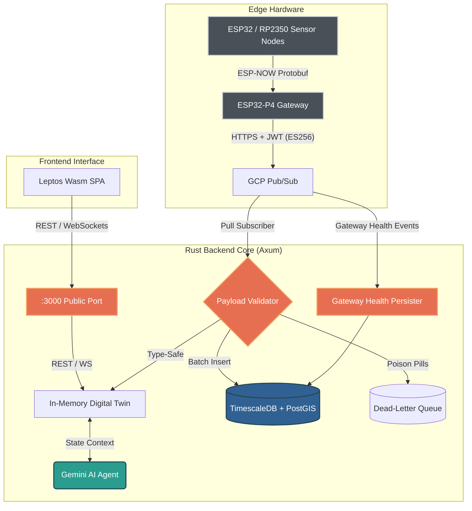

# Oscar Mora | Conservation Technologist & Embedded Systems Engineer

[](https://oscar-bio.dev/)
[](https://linkedin.com/in/oscar-bio-dev)
[](https://www.rust-lang.org/)
[](https://github.com/tokio-rs/axum)
[](https://www.timescale.com/)
[](https://opensource.org/licenses/MIT)

[English](README.md) • [Versión en Español](README.es.md)

---

## About Me

I am a **Conservation Technologist**, **Marine Biologist**, and **Embedded Systems Engineer** based in Pueblo West, Colorado. I bridge the gap between ecological research and bare-metal instrumentation, translating complex environmental requirements into low-power IoT monitoring nodes, resilient telemetry infrastructure, and data-driven analytical platforms.

As the founder of **[EcoWest Instrument](https://oscar-bio.dev/)**, I build ruggedized hardware and software solutions engineered to withstand extreme field deployments.

- **Website & Portfolio:** [https://oscar-bio.dev/](https://oscar-bio.dev/)
- **Core Focus:** In-situ environmental sensing, low-power edge telemetry, distributed time-series architectures, and applied edaphic biodiversity modeling.
- **Location:** Pueblo West, Colorado, United States.

---

## Featured Work & Initiatives

- **[EcoWest Instrument](https://oscar-bio.dev/):** Commercial and scientific instrumentation for soil and aquatic ecosystems. We engineer autonomous field loggers, low-power LoRa/ESP-NOW field gateways, and multi-parameter sensor arrays.
- **Telemetry Hub (This Repository):** Edge-to-cloud telemetry ingestion and digital twin platform built with Rust (Axum, Tokio) and Leptos WebAssembly, backed by TimescaleDB.
- **Ecological & Edaphic Research:** Applied studies in soil biodiversity and earthworm taxonomy, correlating continuous microclimate and soil chemistry metrics with biological population dynamics.

---

## Tech Stack

| Domain | Technologies & Tools |
|---|---|
| **Languages** | Rust (Backend, WebAssembly), Embedded C/C++, SQL, Python, Bash |
| **Microcontrollers & Edge** | Espressif (ESP32-P4 Gateway, ESP32-C6, ESP32-WROOM), Raspberry Pi (RP2350, RP2040), STMicroelectronics (STM32) |
| **Firmware & RTOS** | FreeRTOS, ESP-IDF, Pico SDK, Nanopb (Protocol Buffers) |
| **Sensors & Transduction** | Bosch Sensortec BME688 (IAQ, VOC, temp, humidity, pressure), Sensirion SCD41 (Photoacoustic NDIR CO2), Bosch BMV080 (Laser Particulate PM1.0/PM2.5/PM10), Optical Dissolved Oxygen & pH probes |
| **Backend Architecture** | Rust (Axum, Tokio, Tower), Google Cloud Pub/Sub, WebSockets, JWT (ES256), REST APIs |
| **Storage & Spatial Data** | PostgreSQL 16, TimescaleDB (Hypertables, compression policies), PostGIS (spatial indexing), SQLx |
| **Web HMI & Dashboard** | Leptos (WebAssembly / Wasm SPA), Gruvbox Hard Dark theme, real-time WebSocket state synchronization |
| **Cloud & Intelligence** | Google Gemini AI (Cognitive Digital Twin contextual telemetry reasoning), GCP Pub/Sub, Docker Compose |
| **Engineering Rigor** | Zero-warning pedantic Clippy (`-D warnings`), automated vulnerability auditing (`cargo audit`), Conventional Commits |

---

## Telemetry Hub: Project Architecture

This repository hosts the source code for the **Ecological Telemetry Hub**, an edge-to-cloud platform designed to ingest, validate, persist, and visualize high-frequency environmental sensor data.

### System Diagram



### Key Technical Characteristics

- **Unified Mega-Schema (v2.0 - 33 Fields):** A single Protobuf contract shared between embedded C firmware (Nanopb) and backend Rust services (`prost`), spanning physical metrics (temperature, humidity, pressure), particulate counts, gas resistance, IAQ, virtual sensors (eCO2, bVOC), and optical diagnostics.
- **Lossless Serialization:** Wire payloads use compact `f32` serialization over radio and cloud queues, safely widening into `f64` for high-precision analytical persistence in TimescaleDB hypertables.
- **Resilient Cloud Ingestion & DLQ:** Asynchronous GCP Pub/Sub Pull Subscriber verifies payload integrity and validates UUID format. Malformed packets ("poison pills") are diverted to a dedicated Dead-Letter Queue (`telemetry_dlq`) rather than triggering infinite retry storms.
- **In-Memory Digital Twin:** Thread-safe state representation (`Arc<RwLock<LruCache>>` capped at 10,000 devices) delivering sub-millisecond retrieval of active sensor node states for queries and WebSocket clients.
- **Cognitive AI Integration:** Context-aware telemetry reasoning powered by Google Gemini, querying real-time Digital Twin state under strict schema and prompt-injection defenses.
- **WebAssembly HMI:** Responsive Single Page Application built in Rust using Leptos, featuring real-time WebSocket reconnects, sensor calibration state badges (`is_calibrating`), laser obstruction alerts (`is_laser_obstructed`), and network transmission latency tracking without JavaScript overhead.

---

## Quick Start

### Prerequisites
- [Rust](https://rustup.rs/) (1.85+ stable)
- [Docker & Docker Compose](https://docs.docker.com/compose/)
- [Trunk](https://trunkrs.dev/) (`cargo install trunk`)

### Setup & Run

```bash
# 1. Clone the repository
git clone https://github.com/oscar-bio-dev/oscar-bio-dev.git
cd oscar-bio-dev

# 2. Launch database and Pub/Sub emulator
docker compose up -d

# 3. Configure environment variables
cp .env.example .env
# Edit .env to set your DATABASE_URL and optional GEMINI_API_KEY

# 4. Build the WebAssembly frontend
cd frontend
trunk build
cd ..

# 5. Run the Axum backend server (runs migrations automatically)
cargo run -p backend
```

Once running, access the services locally:
- **Web Dashboard & API:** `http://localhost:3000/`
- **Swagger / OpenAPI Documentation:** `http://localhost:3000/swagger-ui/`
- **Health Check Endpoint:** `http://localhost:3000/health`

---

## Documentation & References

Technical deep dives, operation guides, and project management artifacts are located in `docs/`:

- [System Architecture](docs/ARCHITECTURE.md) - Deep dive into Mega-Schema (33 fields), TimescaleDB hypertables, DLQ, and state models.
- [Engineering Roadmap](docs/ROADMAP.md) - Architectural milestones, completed phases, and upcoming features.
- [Operational Runbook](docs/RUNBOOK.md) - Deployment, database migrations, service validation, and disaster recovery procedures.
- [Contributing Guidelines](CONTRIBUTING.md) - Code standards, pedantic clippy quality gates, and commit workflow.
- [Changelog](CHANGELOG.md) - Chronological release notes and migration history.

---

## Contact & Connect

- **Personal Website:** [https://oscar-bio.dev/](https://oscar-bio.dev/)
- **Company:** [EcoWest Instrument](https://oscar-bio.dev/)
- **LinkedIn:** [oscar-bio-dev](https://linkedin.com/in/oscar-bio-dev)
- **Email:** [oscar_bio_dev@outlook.com](mailto:oscar_bio_dev@outlook.com)
