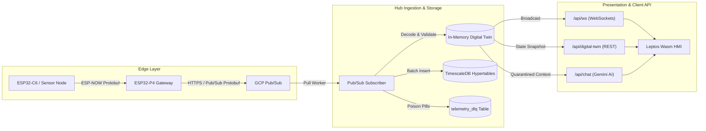

# Telemetry Hub - API & Protocol Reference Manual

This document provides technical specifications and contract definitions for all data exchange interfaces across the **Ecological Telemetry Hub** (`telemetry-hub`), including Protocol Buffers schemas, GCP Pub/Sub cloud ingestion, Axum REST endpoints, WebSockets streaming, and Dead-Letter Queue (DLQ) triage.

---

## 1. Architectural Overview & Protocols

The platform operates an asynchronous, zero-cost edge-to-cloud telemetry pipeline:



### Transport Protocols

| Protocol | Usage | Port / Endpoint | Payload Format |
|---|---|---|---|
| **Protocol Buffers (proto3)** | Edge radio & Cloud Pub/Sub wire format | `projects/oscar-bio-dev-project/topics/room-telemetry` | Binary (`prost` / Nanopb) |
| **HTTP/1.1 REST** | Queries, health checks, authentication, DLQ triage | `:3000` (Public Axum router) | JSON (`application/json`) |
| **WebSocket** | Real-time telemetry broadcast to HMI clients | `:3000/api/ws` | JSON (`text` frames) |
| **OpenAPI / Swagger** | Interactive API specification | `:3000/swagger-ui` | OpenAPI 3.0 (`utoipa`) |

---

## 2. Protocol Buffers & Serialization Contracts

Binary contracts are located in the `proto/` directory and compiled with `prost` in Rust and Nanopb in embedded C.

### 2.1 Mega-Schema: `proto/telemetry.proto`

The canonical single source of truth for all sensor nodes and edge gateways. Tags are immutable and strictly non-reusable.

```protobuf
syntax = "proto3";

package telemetry;

message TelemetryPayload {
    // ── Versioning ──────────────────────────────────────────
    uint32 protocol_version = 1;          // Versión del protocolo de cable (v2)
    uint32 schema_version = 2;            // Versión del esquema de telemetría (v2)

    // ── Identidad e Idempotencia (inyectados por Gateway P4) ─
    string event_id = 3;                  // UUID v4 canónico para deduplicación
    string gateway_id = 4;                // MAC del Gateway (formato XX:XX:XX:XX:XX:XX)
    string device_id = 5;                 // MAC del nodo sensor emisor
    uint32 node_sequence = 6;             // Contador secuencial monotónico del nodo

    // ── Tiempos ─────────────────────────────────────────────
    uint64 measured_at_ms = 7;            // Epoch ms en el sensor (vía RTC RV-1805)
    uint64 ingested_at_ms = 8;            // Epoch ms al ingresar al Gateway P4

    // ── Ambiental y Calidad de Aire (BME688 / BSEC / SCD41) ─
    optional float temperature = 9;       // °C compensada (-50.0 a 150.0)
    optional float humidity = 10;         // % RH compensada (0.0 a 100.0)
    optional float pressure = 11;         // hPa presión barométrica (300.0 a 1100.0)
    optional float gas_resistance = 12;   // Ohms resistencia MOX (>= 0.0)
    optional float iaq = 13;              // Índice de Calidad de Aire BSEC (0 a 500)
    optional uint32 co2 = 14;             // ppm CO2 NDIR fotoacústico (0 a 40000)

    // ── Partículas (BMV080 Láser) — Concentración de Masa ───
    optional float pm1_0 = 15;            // µg/m³ (0.0 a 1000.0)
    optional float pm2_5 = 16;            // µg/m³ (0.0 a 1000.0)
    optional float pm10_0 = 17;           // µg/m³ (0.0 a 1000.0)

    // ── Agua y Suelo (Reservado) ────────────────────────────
    optional float ph = 18;               // Unidades pH (0.0 a 14.0)
    optional float dissolved_oxygen = 19; // mg/L Oxígeno Disuelto (0.0 a 40.0)

    // ── Diagnósticos del Nodo ───────────────────────────────
    optional uint32 battery_mv = 20;      // Milivoltios de alimentación (ADC)
    optional uint32 sleep_cycles = 21;    // Ciclos de deep sleep desde arranque
    optional bool is_calibrating = 22;    // true = warmup BSEC activo (12 pulsos iniciales)

    // ── VOCs y CO2 Equivalente (BSEC Virtual Sensors) ───────
    optional float eco2 = 23;             // ppm CO2 equivalente derivado de VOCs
    optional float bvoc = 24;             // ppm Breath VOC equivalente
    optional float tvoc = 25;             // ppb Total VOC equivalente

    // ── Partículas (BMV080 Láser) — Concentración Numérica ──
    optional float pm1_0_count = 26;      // partículas/m³
    optional float pm2_5_count = 27;      // partículas/m³
    optional float pm10_0_count = 28;     // partículas/m³

    // ── Estado de Hardware del Sensor Láser ──────────────────
    optional bool is_laser_obstructed = 29;   // true = lente obstruida o sucia
    optional bool is_pm_out_of_range = 30;    // true = PM2.5 satura escala (>1000 µg/m³)
    optional float laser_runtime = 31;        // Segundos acumulados de emisión láser

    // ── Status Report Pasivo del Nodo ────────────────────────
    optional uint32 system_error_bitmask = 32; // Bitmask de códigos de falla
    optional NodeStatus status = 33;           // Estado de operación del nodo
}

enum NodeStatus {
    MONITORING = 0;
    CALIBRATING = 1;
    SELF_TESTING = 2;
    HARDWARE_ERROR = 3;
}

enum Command {
    CMD_NONE = 0;
    CMD_RUN_SELF_TEST = 1;
    CMD_REBOOT = 2;
}

message GatewayAck {
    optional Command command = 1;
    optional uint64 current_epoch_s = 2;
}

message DiagnosticReport {
    optional uint32 system_error_bitmask = 1;
    optional bool scd41_passed = 2;
    optional bool bmv080_passed = 3;
    optional bool bme688_passed = 4;
}
```

### 2.2 Diagnósticos del Gateway: `proto/gateway_health.proto`

Canal de telemetría auxiliar transmitido por los gateways ESP32-P4 para monitorear almacenamiento MicroSD, memoria y degradación.

```protobuf
syntax = "proto3";

package diagnostics;

message GatewayHealthEvent {
    string gateway_id = 1;        // MAC del gateway (ej. "gateway-AA:BB:CC:DD:EE:FF")
    bool is_degraded_mode = 2;    // True si la tarjeta MicroSD ha fallado o fue extraída
    bool sd_card_mounted = 3;     // Estado de montaje del sistema de archivos VFS
    uint32 sd_card_total_mb = 4;  // Capacidad total de almacenamiento (MB)
    uint32 sd_card_free_mb = 5;   // Espacio libre disponible (MB)
    uint32 sd_io_errors = 6;      // Contador acumulado de errores de E/S
    uint32 uptime_seconds = 7;    // Tiempo de actividad continuo en segundos
    uint32 free_heap_bytes = 8;   // Memoria libre en SRAM interna
    string alert_message = 9;     // Mensaje crítico de diagnóstico para operadores
}
```

---

## 3. Ingestión en la Nube: GCP Pub/Sub

El worker de fondo (`backend::infrastructure::pubsub::start_pubsub_worker`) suscribe de forma continua a la suscripción de telemetría de Google Cloud Pub/Sub.

### 3.1 Nombres de Recursos Canónicos

| Parámetro | Valor por Defecto / Configuración |
|---|---|
| **Tópico de Ingesta** | `projects/oscar-bio-dev-project/topics/room-telemetry` |
| **Suscripción Pull** | `projects/oscar-bio-dev-project/subscriptions/room-telemetry-sub` |
| **Variable de Entorno** | `PUBSUB_SUBSCRIPTION_NAME` |

### 3.2 Flujo de Validación e Idempotencia

1. **Decodificación Protobuf:** El buffer binario entrante se parsea mediante `TelemetryPayloadPb::decode`.
2. **Validación de Identidad e Idempotencia:**
   - Se verifica que `event_id` sea un **UUIDv4** válido y parseable (`uuid::Uuid::parse_str`).
   - Se descartan o registran duplicados antes de insertar en base de datos.
3. **Conversión y Tipado Fuerte (`TryFrom`):**
   - Los campos `float` (f32) del cable se amplían a `f64` sin pérdida.
   - Cada métrica física pasa por su tipo de dominio (`Temperature`, `Humidity`, `Ph`, `Iaq`, etc.). Si un valor excede el rango físico admisible (p. ej. pH > 14.0 o IAQ > 500.0), la conversión falla de forma inmediata.
4. **Almacenamiento Concurrente:**
   - La carga validada se almacena en el **Digital Twin** en memoria (`LruCache`).
   - Se inserta en la hypertable `telemetry` de TimescaleDB.
   - Se emite en tiempo real a través del canal de difusión `broadcast` para suscriptores WebSockets.

### 3.3 Semántica de Poison Pills y Dead-Letter Queue (DLQ)

Cuando un paquete binario falla la decodificación Protobuf, contiene un UUID corrupto o viola las restricciones del dominio, se clasifica como **Poison Pill**:

- El buffer de datos se trunca defensivamente a **4.096 bytes (4 KB)** para evitar desbordamientos de memoria o inyecciones masivas.
- Se persiste en la tabla `telemetry_dlq` con la fecha actual, el motivo del fallo (`error_reason`) y el payload hexadecimal/binario.
- Se envía un **ACK** a Pub/Sub para evitar tormentas de reintentos infinitos que degraden el rendimiento del pipeline.

---

## 4. Endpoints HTTP / REST (Axum)

El servidor público expone endpoints REST bajo el puerto `:3000` (o el configurado en `PORT`).

### 4.1 Probes de Salud y Disponibilidad

#### `GET /health`
Liveness probe para Kubernetes y balanceadores de carga.
- **Autenticación:** Pública (sin token).
- **Código de Respuesta:** `200 OK`
- **Cuerpo:**
  ```json
  {
    "status": "UP"
  }
  ```

#### `GET /ready`
Readiness probe para validar la conectividad a TimescaleDB y el estado activo del worker Pub/Sub.
- **Autenticación:** Pública.
- **Código de Respuesta:**
  - `200 OK`: La base de datos y Pub/Sub están operativos.
  - `503 SERVICE UNAVAILABLE`: La conexión con la base de datos o Pub/Sub ha fallado.
- **Cuerpo (200 OK):**
  ```json
  {
    "status": "READY",
    "database": "CONNECTED",
    "pubsub": "CONNECTED"
  }
  ```

---

### 4.2 Autenticación de Operador

#### `POST /api/auth/login`
Autentica a un operador de campo emitiendo un token JWT firmado mediante `HS256`.
- **Autenticación:** Pública (protegido con rate-limiting).
- **Cuerpo de Solicitud (`application/json`):**
  ```json
  {
    "token": "TU_CLAVE_DE_OPERADOR_AQUI"
  }
  ```
- **Seguridad:** Comparación en tiempo constante (`subtle::ConstantTimeEq`) para prevenir ataques de canal lateral (timing attacks).
- **Códigos de Respuesta:**
  - `200 OK`:
    ```json
    {
      "token": "eyJhbGciOiJIUzI1NiIsInR5cCI6IkpXVCJ9..."
    }
    ```
  - `401 UNAUTHORIZED`: Clave de operador incorrecta.
  - `500 INTERNAL SERVER ERROR`: `JWT_SECRET` no configurado en entorno (fail-closed).

---

### 4.3 Gemelo Digital (Digital Twin)

#### `GET /api/digital-twin`
Devuelve el volcado actual del estado de los nodos activos almacenados en la memoria RAM del servidor.
- **Autenticación:** Pública.
- **Código de Respuesta:** `200 OK`
- **Cuerpo:** Mapa indexado por `device_id`:
  ```json
  {
    "AA:BB:CC:11:22:33": {
      "device_id": "AA:BB:CC:11:22:33",
      "timestamp": 1740000000,
      "temperature": 23.45,
      "humidity": 45.12,
      "pressure": 1013.25,
      "gas_resistance": 54200.0,
      "iaq": 28.5,
      "co2": 512,
      "pm1_0": 4.2,
      "pm2_5": 7.8,
      "pm10_0": 12.1,
      "is_calibrating": false,
      "is_laser_obstructed": false,
      "status": "MONITORING"
    }
  }
  ```

---

### 4.4 Asistente Cognitivo IA (Gemini)

#### `POST /api/chat`
Consulta interactiva sobre el estado del Gemelo Digital con análisis contextual mediante Google Gemini.
- **Autenticación:** Pública (estricto rate limiting: 5 req/min por IP).
- **Cuerpo de Solicitud (`application/json`):**
  ```json
  {
    "message": "¿Cuál es el nodo con mayor concentración de CO2 en este momento?"
  }
  ```
- **Protección XPIA:** Los datos de telemetría se inyectan en el prompt de usuario delimitados dentro de etiquetas defensivas (`<untrusted_telemetry_data>`), fuera de la directiva `system_instruction` para mitigar ataques de inyección de prompt indirecto.
- **Códigos de Respuesta:**
  - `200 OK`:
    ```json
    {
      "response": "El nodo AA:BB:CC:11:22:33 registra actualmente 512 ppm de CO2, dentro de los rangos operacionales normales."
    }
    ```
  - `429 TOO MANY REQUESTS`: Se ha superado el límite de 5 consultas por minuto.
  - `500 INTERNAL SERVER ERROR`: Fallo de conexión o respuesta de la API de Google Gemini.

---

### 4.5 Consola DLQ (Dead-Letter Queue)

#### `GET /api/dlq/recent`
Permite a los operadores inspeccionar los últimos 50 registros corruptos o envenenados (*poison pills*) recibidos en el hub.
- **Autenticación:** **Obligatoria**. Requiere cabecera:
  ```http
  Authorization: Bearer <JWT_TOKEN>
  ```
- **Códigos de Respuesta:**
  - `200 OK`:
    ```json
    [
      {
        "id": 1,
        "failed_at": "2026-10-25T17:15:30Z",
        "error_reason": "Invalid Protobuf: wire format corrupt",
        "payload_hex": "080212243162393863383935...",
        "payload_truncated": false
      }
    ]
    ```
  - `401 UNAUTHORIZED`: Token ausente, corrupto o expirado.
  - `403 FORBIDDEN`: Permisos insuficientes.

---

## 5. Streaming en Tiempo Real: WebSockets

#### `GET /api/ws`
Canal bidireccional para recepción de telemetría validada con latencia sub-milisegundo.

- **Conexión:**
  ```javascript
  const socket = new WebSocket("ws://localhost:3000/api/ws");
  socket.onmessage = (event) => {
    const payload = JSON.parse(event.data);
    console.log("Nodo actualizado:", payload.device_id, payload.temperature);
  };
  ```
- **Flujo de Mensajes:** Cada vez que el suscriptor de Pub/Sub valida una carga de un nodo, la serializa en JSON y la envía a través de un canal `tokio::sync::broadcast` a todas las conexiones activas.
- **Resiliencia en el Cliente:** La interfaz Leptos (`frontend/src/pages/room_monitoring.rs`) implementa backoff exponencial automático (1s, 2s, 4s, 8s, 16s, máx 30s) y soporte de cancelación limpia (`on_cleanup`).

---

## 6. Seguridad, Rate Limiting y Cabeceras HTTP

| Mecanismo de Seguridad | Configuración | Comportamiento |
|---|---|---|
| **Límite de Carga HTTP** | 16 KB (`RequestBodyLimitLayer`) | Deniega peticiones REST masivas con `413 Payload Too Large`. |
| **Timeout de Petición** | 30 segundos (`TimeoutLayer`) | Cancela conexiones colgadas con `408 Request Timeout`. |
| **Rate Limiter General** | 30 burst / 200 ms por IP (`tower-governor`) | Mitiga ataques de denegación de servicio en endpoints públicos. |
| **Rate Limiter Chat** | 2 burst / 12 seg (~5 req/min) | Evita saturación de la cuota de la API de Google Gemini. |
| **CORS Fail-Closed** | `CORS_ORIGIN` en `.env` | Si no está configurado, deniega peticiones *cross-origin* por defecto. |
| **Extracción de IP** | `SmartIpKeyExtractor` | Extrae la IP de cliente validando cabeceras `X-Forwarded-For` contra proxies confiables. |
| **Cabeceras de Seguridad** | Middleware HTTP global | Inyecta `X-Content-Type-Options: nosniff`, `X-Frame-Options: DENY`, `Strict-Transport-Security`. |
