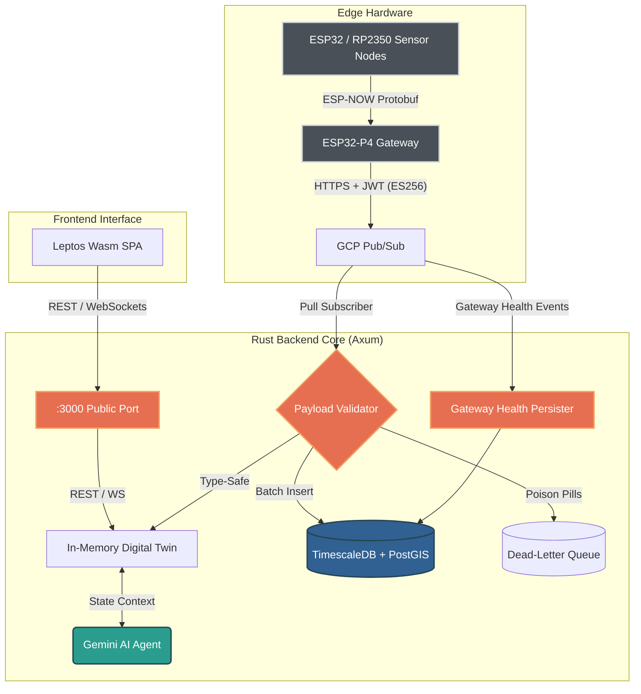

# Telemetry Hub - System Architecture & Technical Specifications

This document provides in-depth technical specifications and architectural details for the **Ecological Telemetry Hub** developed by **EcoWest Instrument**. For exhaustive Protocol Buffers contracts, GCP Pub/Sub message schemas, REST routes, and WebSocket specifications, consult the [API & Protocol Reference Manual](API.md).

---

## 1. System Overview & Ingestion Flow

The Telemetry Hub is an edge-to-cloud distributed pipeline designed to ingest, validate, persist, and visualize real-time environmental metrics from remote sensor deployments.

---

## 2. Unified Mega-Schema Specification (v2.0)

Telemetry payloads are serialized at the edge using Protocol Buffers (`proto/telemetry.proto`) via Nanopb in C, and deserialized in Rust using `prost`. The schema spans 33 canonical fields:

| Field Index | Name | Wire Type | Storage Type | Physical Sensor / Origin |
|---|---|---|---|---|
| 1 | `device_id` | `string` | `VARCHAR(64)` | Hardware MAC / Unique identifier |
| 2 | `timestamp` | `int64` | `TIMESTAMPTZ` | Microsecond epoch from edge RTC |
| 3 | `temperature` | `float` | `DOUBLE PRECISION` | Bosch BME688 / Sensirion SCD41 (°C) |
| 4 | `humidity` | `float` | `DOUBLE PRECISION` | Bosch BME688 / Sensirion SCD41 (% RH) |
| 5 | `pressure` | `float` | `DOUBLE PRECISION` | Bosch BME688 (hPa) |
| 6 | `gas_resistance` | `float` | `DOUBLE PRECISION` | Bosch BME688 (Ohms) |
| 7 | `iaq` | `float` | `DOUBLE PRECISION` | BSEC calculated Indoor Air Quality (0..500) |
| 8 | `co2` | `float` | `DOUBLE PRECISION` | Sensirion SCD41 Photoacoustic NDIR (ppm) |
| 9 | `pm1_0` | `float` | `DOUBLE PRECISION` | Bosch Sensortec BMV080 (µg/m³) |
| 10 | `pm2_5` | `float` | `DOUBLE PRECISION` | Bosch Sensortec BMV080 (µg/m³) |
| 11 | `pm10_0` | `float` | `DOUBLE PRECISION` | Bosch Sensortec BMV080 (µg/m³) |
| 12 | `ph` | `float` | `DOUBLE PRECISION` | Analog/Digital pH probe (pH units) |
| 13 | `dissolved_oxygen` | `float` | `DOUBLE PRECISION` | Optical Dissolved Oxygen probe (mg/L) |
| 14 | `battery_mv` | `uint32` | `INTEGER` | Battery supply voltage via ADC (mV) |
| 15 | `sleep_cycles` | `uint32` | `INTEGER` | Deep sleep cycle count since boot |
| 16 | `rssi` | `int32` | `INTEGER` | ESP-NOW / Wi-Fi signal strength (dBm) |
| 17 | `snr` | `float` | `DOUBLE PRECISION` | Signal-to-Noise Ratio (dB) |
| 18 | `seq_number` | `uint32` | `INTEGER` | Monotonic transmission sequence number |
| 19 | `latitude` | `double` | `DOUBLE PRECISION` | GPS receiver coordinate |
| 20 | `longitude` | `double` | `DOUBLE PRECISION` | GPS receiver coordinate |
| 21 | `altitude` | `float` | `DOUBLE PRECISION` | GPS elevation (meters) |
| 22 | `bsec_status` | `uint32` | `INTEGER` | Bosch Sensortec BSEC driver status code |
| 23 | `static_iaq` | `float` | `DOUBLE PRECISION` | Uncalibrated / static IAQ score |
| 24 | `co2_equivalent` | `float` | `DOUBLE PRECISION` | Virtual eCO2 calculated from VOC (ppm) |
| 25 | `breath_voc_equivalent` | `float` | `DOUBLE PRECISION` | Breath VOC equivalent concentration (ppm) |
| 26 | `comp_gas_value` | `float` | `DOUBLE PRECISION` | Temperature/humidity compensated gas value |
| 27 | `gas_percentage` | `float` | `DOUBLE PRECISION` | Relative gas variation percentage (%) |
| 28 | `pm_number_concentration` | `float` | `DOUBLE PRECISION` | Particulate particle count (particles/cm³) |
| 29 | `typical_particle_size` | `float` | `DOUBLE PRECISION` | Mean optical particulate diameter (µm) |
| 30 | `sensor_run_mode` | `uint32` | `INTEGER` | Operational mode (LP, ULP, High-speed) |
| 31 | `is_calibrating` | `bool` | `BOOLEAN` | True when BSEC is undergoing baseline warmup |
| 32 | `is_laser_obstructed` | `bool` | `BOOLEAN` | Optical alert for dust/debris on BMV080 lens |
| 33 | `sensor_error_flags` | `uint32` | `INTEGER` | Bitmask of hardware diagnostic errors |

---

## 3. Storage Architecture: TimescaleDB & PostGIS

Telemetry data is persisted in PostgreSQL 16 enhanced with TimescaleDB and PostGIS extensions:

- **Hypertable Partitioning:** The `telemetry` table is partitioned into 7-day chunks by `measured_at`, enabling query pruning and high ingestion throughput.
- **Compression Policies:** Chunks older than 14 days are compressed using TimescaleDB column-oriented compression, yielding >85% disk storage reduction.
- **Dead-Letter Queue (`telemetry_dlq`):** Malformed payloads, invalid UUIDs, or unparseable binary streams are stored in `telemetry_dlq` alongside the raw byte array and failure reason for non-blocking offline triage.
- **Gateway Health Tracking (`gateway_health`):** Edge gateways periodically stream hardware metrics (free heap, SD card health, uptime, dropped radio packets) into a dedicated hypertable.

---

## 4. Ingestion Resilience & DLQ Semantics

The cloud ingestion worker follows strict reliability patterns:

1. **UUID Verification:** Every incoming `event_id` must conform to standard UUID v4. Payloads with invalid identifiers are rejected and diverted immediately to `telemetry_dlq` as *Poison Pills*.
2. **Timestamp Fallback:** If `measured_at_ms == 0` (indicating uninitialized RTC or uncalibrated GPS sync at the node), the system logs a warning and injects the worker ingestion timestamp (`Utc::now()`) to ensure monotonicity.
3. **Lossless Wire-to-Domain Conversion:** Wire floats (`f32`) are promoted to `f64` in domain structures (`TelemetryData`) to ensure lossless IEEE-754 representation before database insertion.

---

## 5. In-Memory Digital Twin & Concurrency

- **State Container:** `Arc<RwLock<LruCache<String, TelemetryRecord>>>` capped at 10,000 unique edge nodes.
- **Sub-Millisecond Queries:** Read queries from REST endpoints, WebSocket broadcasters, and AI reasoning pipelines acquire read locks (`.read().await`) without hitting disk.
- **State Invalidation & Staleness:** Sensor readings older than 300 seconds are visually attenuated ("Stale" dimmed indicator) on the HMI.

---

## 6. Reactive WebAssembly HMI (Leptos)

The user interface is compiled directly to WebAssembly using Rust and Leptos (CSR):

- **Zero JavaScript Overhead:** Pure Rust compilation eliminates heavy node runtime dependencies.
- **Real-Time Streaming:** Subscribes to backend WebSockets (`/api/ws`) with exponential backoff automatic reconnection.
- **Diagnostic Observability:**
  - Dynamic **"⏳ Calibrando Sensores"** badge rendered when `is_calibrating == true`.
  - Prominent **"⚠️ ALERTA ÓPTICA"** indicator triggered if `is_laser_obstructed == true`.
  - Live **Network Transmission Latency** calculation (`ingested_at - measured_at`) in milliseconds.
- **Industrial Terminal Aesthetic:** Gruvbox Hard Dark color palette (`#1d2021`, `#282828`, `#ebdbb2`, `#b8bb26`, `#fe8019`, `#fb4934`).
